<p align="center">
  
</p>

<h1 align="center">Apogeu<br><sub><sup><sup><sub>Copyright (©) 2026 Erik Pimenta</sub></sup></sup></sub></h1>

<p align="center">
  Orquestrador de agentes de IA em que um supervisor coordena pesquisador, redator e revisor para entregar textos prontos, com fontes.<br>
  Você descreve o artigo, acompanha cada decisão, busca e revisão ao vivo e recebe a versão final só depois que o revisor aprova.
</p>

<p align="center">
  <b>Versão 1.0.0</b><br>
  Python 3.11+ · LangGraph · LangChain · FastAPI · SQLite · Next.js 16 · React 19 · TypeScript · OpenAI, Anthropic, Ollama ou modo demonstração
</p>

---

<p align="center">
  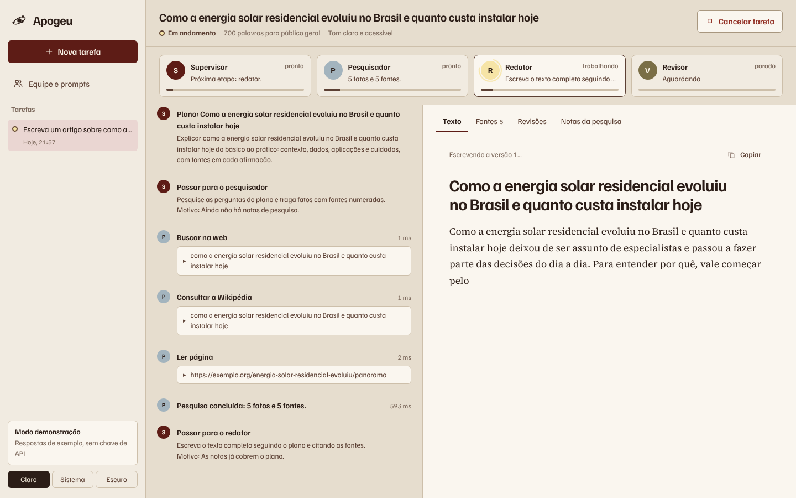
</p>

## O que o Apogeu faz

- **Equipe de quatro agentes** montada como um grafo LangGraph: o **Supervisor** planeja e decide quem trabalha a cada passo, o **Pesquisador** busca na web e na Wikipédia, o **Redator** escreve e o **Revisor** dá nota e pede correções.
- **Ciclo de revisão de verdade**: o texto volta para o redator até atingir a nota mínima ou esgotar as rodadas que você escolheu.
- **Chamadas de ferramentas (function calling)**: buscar na web, consultar a Wikipédia, ler páginas, calcular, ver a data, medir o rascunho e verificar citações. Cada chamada aparece na linha do tempo com argumentos, resultado e duração.
- **Gestão de contexto**: cada agente recebe só o que precisa, dentro de um orçamento de tokens, com corte por prioridade, resumo automático das notas e compactação de resultados antigos de ferramentas.
- **Engenharia de prompts**: prompts de sistema por papel, editáveis na tela **Equipe e prompts**, contexto delimitado por tags e regras contra injeção de instruções vindas da web.
- **Saída estruturada** (Pydantic) para plano, decisões do supervisor e revisões, com nova tentativa e regra padrão quando o modelo erra o formato.
- **Aprovação humana do plano** (human-in-the-loop): o grafo pausa com `interrupt`, você edita o título e as perguntas, deixa uma orientação e aprova ou recusa.
- **Streaming ao vivo** por Server-Sent Events: decisões, ferramentas, uso de contexto e o texto aparecendo palavra por palavra.
- **Fontes numeradas** `[n]` no texto e lista de referências montada automaticamente no final, só com as fontes citadas.
- **Histórico** de tarefas em SQLite, com exportação em Markdown ou JSON (texto, plano, fontes, métricas e todos os eventos).
- **Quatro provedores**: OpenAI, Anthropic, Ollama (local e gratuito) ou **modo demonstração**, que roda sem chave e sem internet.
- **Interface simples** em Next.js com tema claro, escuro ou automático e layout para celular, na mesma paleta do [Crivo](https://github.com/ravelroot/Pixel-Art-Matrix-Editor). A logo é sempre em preto e branco.

## Como a equipe trabalha

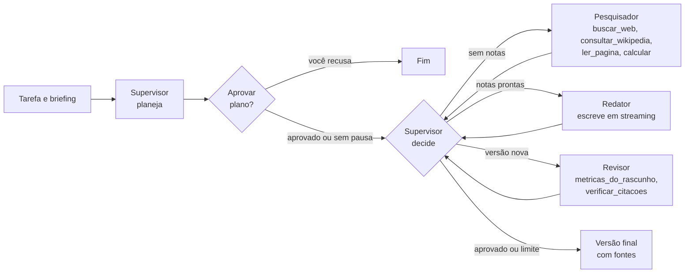

1. **Planejamento**: o supervisor devolve um `Plano` estruturado (título, abordagem, perguntas e etapas).
2. **Decisão com regras de segurança**: a cada passo o supervisor escolhe o próximo agente com saída estruturada (`Decisao`). O código confere a escolha contra regras fixas (pesquisar antes de escrever, revisar toda versão nova, finalizar só depois de uma revisão) e corrige quando o modelo erra. A correção aparece na linha do tempo como **Regra aplicada**.
3. **Pesquisa com ferramentas**: laço ReAct com até 6 rodadas de chamadas, executadas em paralelo, cada resultado truncado e registrado como fonte numerada.
4. **Redação em streaming**: o redator recebe notas, fontes, plano e, nas rodadas seguintes, a revisão anterior e o rascunho anterior.
5. **Revisão**: o revisor mede o rascunho com ferramentas, devolve uma `Revisao` estruturada e o código reprova automaticamente qualquer citação para uma fonte que não existe.
6. **Finalização**: as fontes citadas viram uma seção **Fontes** com links, e as métricas (nota, palavras, legibilidade, versões, tokens e duração) são salvas.

## Gestão de contexto

| Técnica | Onde | O que faz |
|---|---|---|
| Orçamento por agente | `apogeu/contexto.py` | Cada chamada monta o contexto em seções com prioridade (`<tarefa>`, `<briefing>`, `<plano>`, `<notas>`, `<fontes>`, `<revisao>`...). Se passar de `APOGEU_LIMITE_CONTEXTO`, as seções de menor prioridade são cortadas primeiro. |
| Tags delimitadoras | todos os agentes | O contexto vai entre tags XML, o que separa instruções de dados e facilita para o modelo achar cada parte. |
| Resumo das notas | pesquisador | Quando as notas passam de `APOGEU_LIMITE_NOTAS`, um passo de compactação resume tudo mantendo números e citações `[n]`. |
| Compactação de ferramentas | laço ReAct | Resultados antigos de ferramentas são encurtados quando o histórico do laço passa do limite, sem quebrar os pares chamada e resultado. |
| Ferramentas sem argumentos pesados | revisor | `metricas_do_rascunho` e `verificar_citacoes` leem o rascunho pelo estado do grafo, então o modelo não precisa repetir o texto inteiro nos argumentos. |
| Medidor por agente | interface | Cada cartão da equipe mostra quanto do limite a última chamada usou, e cada compactação aparece na linha do tempo. |

## Como rodar

Pré-requisitos: **Python 3.11 ou mais recente** e **Node.js 20.9 ou mais recente** (só para compilar a interface).

**Windows:** dê dois cliques em `iniciar.cmd`.
**Linux / macOS:** `./iniciar.sh`

Os scripts criam o ambiente virtual, instalam as dependências, copiam `.env.example` para `.env`, compilam a interface e sobem o servidor em **http://127.0.0.1:8000**.

Manualmente, no Windows:

```bat
python -m venv .venv
.venv\Scripts\activate
pip install -r requirements.txt
copy .env.example .env
cd frontend && npm install && npm run build && cd ..
python -m apogeu
```

No Linux ou macOS:

```bash
python3 -m venv .venv
source .venv/bin/activate
pip install -r requirements.txt
cp .env.example .env
(cd frontend && npm install && npm run build)
python -m apogeu
```

Para desenvolver a interface com recarga automática, deixe a API rodando e use `cd frontend && npm run dev` (abre em http://localhost:3000 e conversa com a API em http://127.0.0.1:8000).

Com Docker: `docker compose up --build` sobe o Apogeu e um Ollama. Depois rode `docker compose exec ollama ollama pull qwen2.5:7b`.

### Escolha um provedor

Com `APOGEU_PROVEDOR=auto` (padrão), o Apogeu usa o primeiro que encontrar nesta ordem: OpenAI, Anthropic, Ollama e modo demonstração. O provedor ativo aparece no canto inferior da barra lateral.

| Provedor | O que fazer | `.env` |
|---|---|---|
| **OpenAI** | uma chave de API | `OPENAI_API_KEY=...` (modelo padrão `gpt-4.1-mini`) |
| **Anthropic** | uma chave de API | `ANTHROPIC_API_KEY=...` (modelo padrão `claude-sonnet-5-5`) |
| **Ollama** (local e gratuito) | [Ollama](https://ollama.com) e `ollama pull qwen2.5:7b` | nada, se o Ollama estiver rodando |
| **Compatível com OpenAI** (Groq, OpenRouter, LM Studio) | endereço e chave do serviço | `APOGEU_PROVEDOR=openai`, `APOGEU_OPENAI_BASE_URL=...`, `APOGEU_MODELO=...` |
| **Modo demonstração** | nada | `APOGEU_PROVEDOR=demonstracao` |

O modo demonstração usa um modelo de roteiro local que chama as mesmas ferramentas, devolve saídas estruturadas e escreve em streaming, sem rede nem custo. Serve para conhecer a interface, rodar os testes e gravar as capturas deste README. Para pesquisar sem internet, use também `APOGEU_FERRAMENTAS=simuladas`.

A busca na web usa o DuckDuckGo sem chave. Para resultados mais estáveis, crie uma chave na Tavily e use `APOGEU_BUSCA=tavily` com `TAVILY_API_KEY=...`.

Cada agente pode usar um modelo diferente: em **Equipe e prompts**, preencha **Modelo próprio** (por exemplo, um modelo maior só para o redator).

## Telas

| | |
|---|---|
| 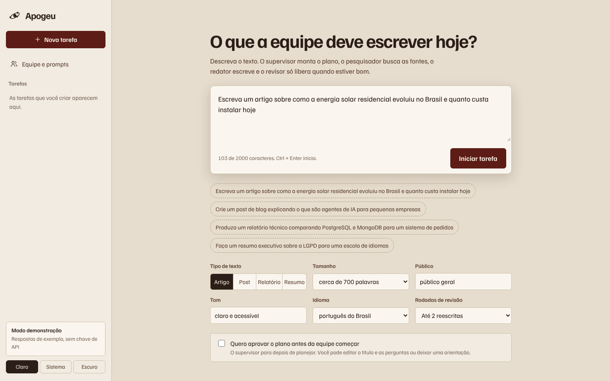 |  |
| **Nova tarefa**: descrição, tipo, tamanho, público, tom, idioma, rodadas de revisão e aprovação do plano | **Equipe trabalhando**: cartões com o que cada agente faz e quanto contexto usou, linha do tempo e texto em streaming |
| 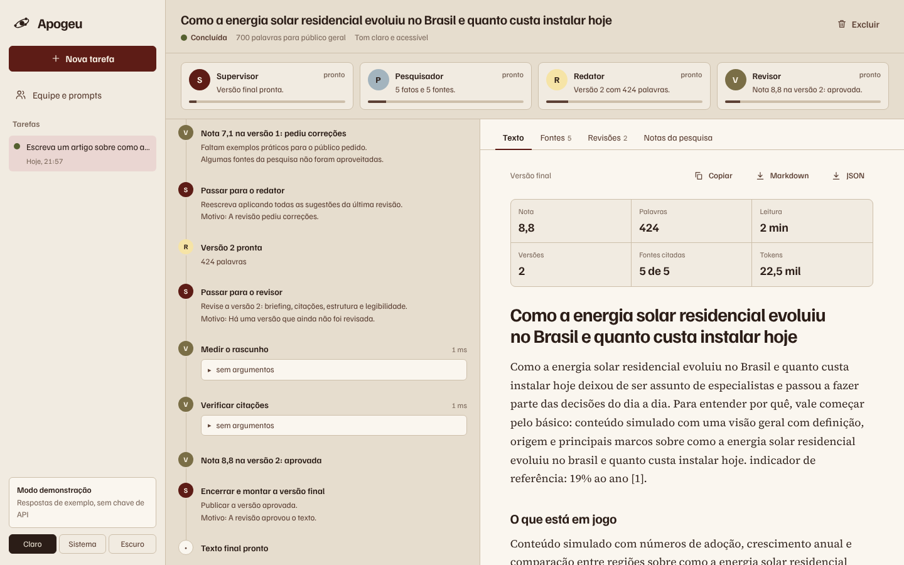 | 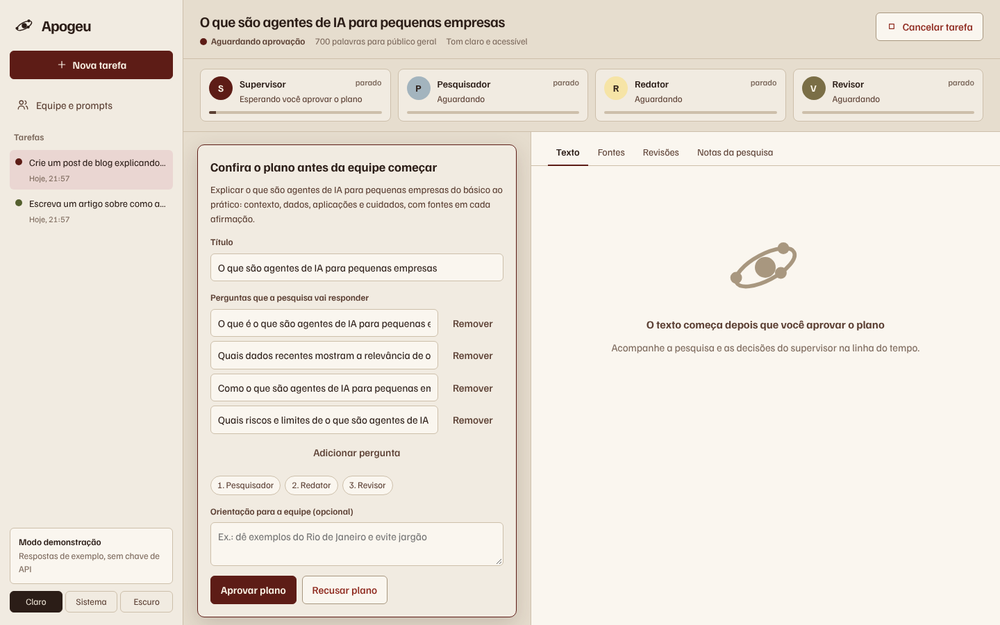 |
| **Texto final** com nota, palavras, leitura, versões, fontes citadas e tokens | **Aprovação do plano**: edite o título e as perguntas, deixe uma orientação, aprove ou recuse |
| 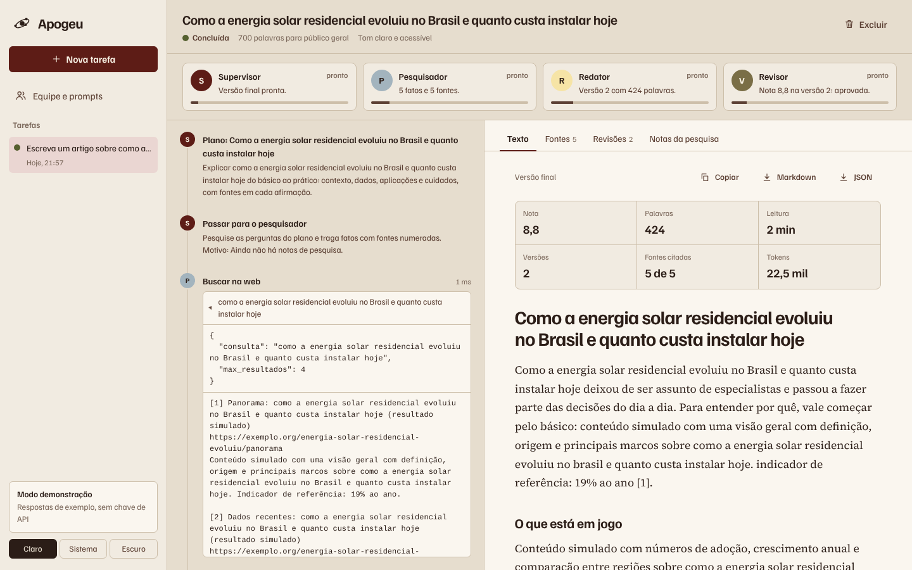 | 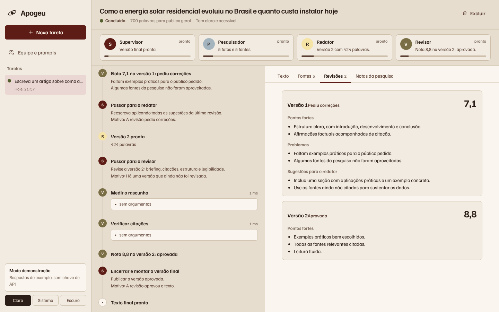 |
| **Chamadas de ferramentas** com argumentos e resultado | **Revisões**: nota, pontos fortes, problemas e sugestões de cada versão |
| 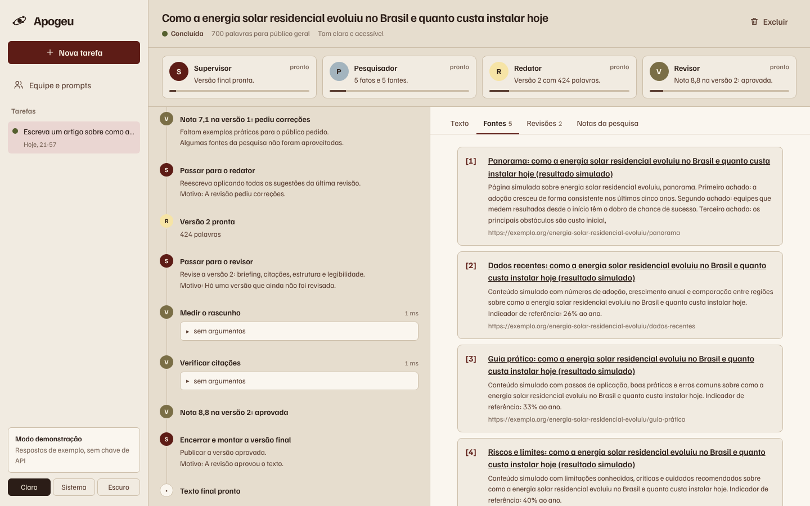 | 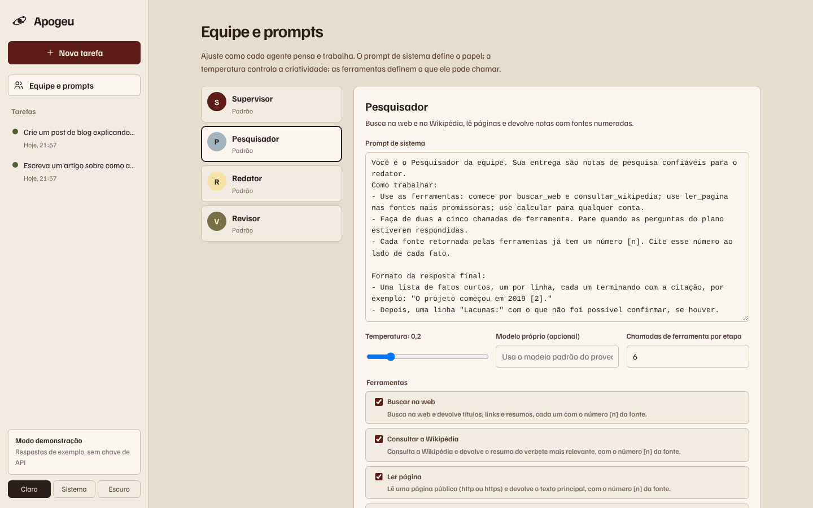 |
| **Fontes** numeradas como no texto | **Equipe e prompts**: prompt de sistema, temperatura, modelo e ferramentas de cada agente |
| 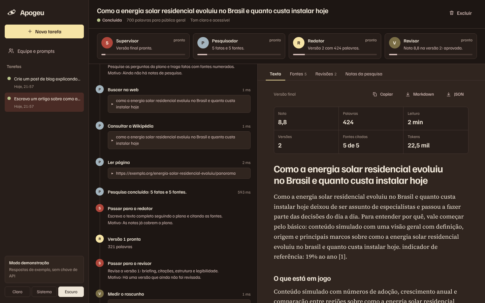 | 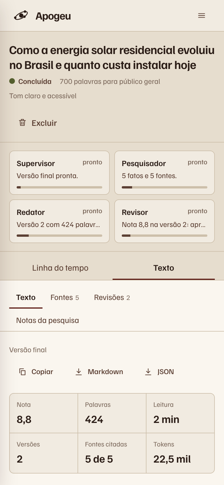 |
| **Tema escuro** | **Celular** |

## Configuração

Todas as opções ficam no `.env` (modelo em [`.env.example`](.env.example)). As principais:

| Variável | Padrão | Função |
|---|---|---|
| `APOGEU_PROVEDOR` | `auto` | `auto`, `openai`, `anthropic`, `ollama` ou `demonstracao` |
| `APOGEU_MODELO` | do provedor | Modelo usado por todos os agentes sem modelo próprio |
| `APOGEU_TEMPERATURA` | `0.3` | Temperatura padrão (cada agente tem a sua na tela Equipe) |
| `APOGEU_BUSCA` | `duckduckgo` | `duckduckgo` ou `tavily` |
| `APOGEU_FERRAMENTAS` | `reais` | `reais` ou `simuladas` (sem internet) |
| `APOGEU_LIMITE_CONTEXTO` | `12000` | Tokens máximos do contexto montado para cada chamada |
| `APOGEU_LIMITE_NOTAS` | `4500` | Acima disso, as notas de pesquisa são resumidas |
| `APOGEU_LIMITE_SAIDA_FERRAMENTA` | `4000` | Caracteres máximos de cada resultado de ferramenta |
| `APOGEU_MAX_PASSOS` | `12` | Decisões do supervisor antes de finalizar à força |
| `APOGEU_MAX_REVISOES` | `2` | Rodadas de reescrita padrão (a tela permite de 0 a 3) |
| `APOGEU_MAX_PESQUISAS` | `2` | Vezes que o pesquisador pode ser chamado na mesma tarefa |
| `APOGEU_NOTA_MINIMA` | `8.0` | Nota mínima para o revisor aprovar |
| `APOGEU_MAX_EXECUCOES` | `3` | Tarefas rodando ao mesmo tempo |
| `APOGEU_TOKEN` | vazio | Se preenchido, a API exige `Authorization: Bearer <token>` |
| `APOGEU_DATABASE_URL` | SQLite em `data/` | Outro banco relacional (PostgreSQL, MySQL) |

## Segurança

- **Leitura de páginas protegida contra SSRF**: só `http` e `https` nas portas 80 e 443, sem usuário e senha na URL, com bloqueio de endereços locais, privados e de metadados de nuvem, inclusive depois de cada redirecionamento, e limite de 2 MB por página.
- **Calculadora sem `eval`**: a expressão é avaliada pela árvore sintática, só com números e operadores aritméticos, com limite de potência.
- **Conteúdo da web tratado como dado**: os prompts mandam ignorar instruções que venham de páginas ou buscas, e o resultado de cada ferramenta é truncado.
- **Validação de entrada** com Pydantic em todas as rotas e lista de ferramentas permitidas por agente.
- **Token opcional** para a API, comparado em tempo constante, e cabeçalhos `X-Content-Type-Options`, `X-Frame-Options` e `Referrer-Policy`.
- **Servidor local por padrão** (`127.0.0.1`) e nenhuma chave gravada no código: tudo vem do `.env`, que fica fora do Git.

## Estrutura

```
apogeu/
  config.py          configuração lida do .env
  esquemas.py        modelos Pydantic: Plano, Decisao, Revisao, Briefing e pedidos da API
  prompts.py         prompts de sistema e modelos de mensagem de cada etapa
  agentes.py         agentes padrão, ferramentas permitidas e personalização salva no banco
  contexto.py        orçamento de tokens, seções com prioridade e compactação
  ferramentas.py     ferramentas, fontes numeradas, proteção contra SSRF e métricas de texto
  llm.py             OpenAI, Anthropic, Ollama e escolha automática do provedor
  demonstracao.py    modelo de roteiro local com ferramentas, saída estruturada e streaming
  grafo.py           grafo LangGraph: planejar, aprovar, supervisionar, pesquisar, redigir, revisar e finalizar
  execucoes.py       fila de tarefas, eventos, interrupção e retomada, cancelamento e exportação
  db.py              tabelas SQLAlchemy de tarefas, eventos e agentes
  api.py             rotas FastAPI, SSE e arquivos da interface
frontend/            interface Next.js + React + TypeScript (exportação estática)
  app/               Nova tarefa e acompanhamento (/), Equipe e prompts (/equipe)
  components/        barra lateral, compositor, equipe, linha do tempo, documento e aprovação do plano
  lib/               cliente da API, tipos e redutor de eventos
scripts/             capturas de tela
docs/                logo e capturas de tela
tests/               testes automatizados
```

## API

Documentação interativa em **http://127.0.0.1:8000/api/docs**.

| Método | Rota | Função |
|---|---|---|
| GET | `/api/saude` | Versão, provedor ativo e limites |
| GET | `/api/agentes` | Agentes com prompt, temperatura, modelo e ferramentas |
| PUT | `/api/agentes/{chave}` | Alterar prompt, temperatura, modelo, ferramentas e iterações |
| POST | `/api/agentes/{chave}/restaurar` | Voltar ao padrão |
| GET | `/api/ferramentas` | Catálogo de ferramentas com descrição e parâmetros |
| GET | `/api/grafo` | Grafo da equipe em Mermaid |
| GET / POST | `/api/execucoes` | Listar e criar tarefas |
| GET / DELETE | `/api/execucoes/{id}` | Abrir e excluir uma tarefa |
| GET | `/api/execucoes/{id}/eventos` | Eventos em Server-Sent Events (aceita `desde` e `Last-Event-ID`) |
| POST | `/api/execucoes/{id}/aprovacao` | Aprovar (com plano editado e orientação) ou recusar o plano |
| POST | `/api/execucoes/{id}/cancelar` | Cancelar uma tarefa em andamento |
| GET | `/api/execucoes/{id}/exportar?formato=markdown` | Texto final em Markdown, ou tudo em JSON com `formato=json` |

```bash
curl -X POST http://127.0.0.1:8000/api/execucoes \
  -H "Content-Type: application/json" \
  -d '{"tarefa": "Escreva um artigo sobre energia solar em residências", "briefing": {"palavras": 600, "publico": "donos de casa"}, "max_revisoes": 1}'

curl -N http://127.0.0.1:8000/api/execucoes/ID_DA_TAREFA/eventos
```

Eventos emitidos: `execucao.criada`, `execucao.iniciada`, `plano.criado`, `plano.aguardando`, `plano.aprovado`, `plano.recusado`, `agente.iniciou`, `agente.concluiu`, `agente.aviso`, `supervisor.decisao`, `ferramenta.chamada`, `ferramenta.resultado`, `contexto.uso`, `contexto.compactado`, `notas.atualizadas`, `fontes.atualizadas`, `rascunho.delta`, `rascunho.atualizado`, `revisao.concluida`, `execucao.concluida`, `execucao.cancelada` e `execucao.erro`.

## Testes

```bash
pip install -r requirements-ci.txt
python -m pytest
```

São 22 testes, todos no modo demonstração e com ferramentas simuladas, sem rede. Eles cobrem o fluxo completo com uma rodada de reescrita, a ordem das decisões do supervisor, as chamadas de ferramentas, o streaming, a tarefa sem rodadas de revisão, a aprovação do plano com edição, a recusa do plano, a aprovação fora de hora, o cancelamento, a exportação e a exclusão, a validação dos pedidos, a edição e a restauração dos agentes, o token da API, a calculadora segura, o bloqueio de endereços internos, o corte do contexto por prioridade, a compactação de resultados de ferramentas, as fontes numeradas, as métricas de texto e citações e as regras do supervisor.

## Licença

[MIT](LICENSE). Use, copie, altere e distribua à vontade. As fontes [Familjen Grotesk](https://fonts.google.com/specimen/Familjen+Grotesk) e [Source Serif 4](https://fonts.google.com/specimen/Source+Serif+4) da interface vêm do [Fontsource](https://fontsource.org/) e são distribuídas sob a SIL Open Font License 1.1.
